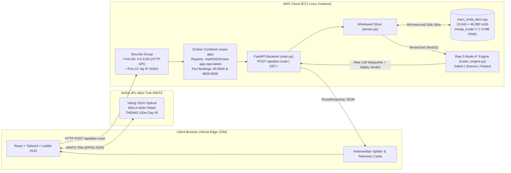

# Mission Mars 1.0
### Planetary Surface Explorer & EVA Mission Control

> **NASA Space Apps Challenge 2026**  
> A planetary-scale surface exploration and path-planning platform for safer astronaut EVAs and autonomous rover traverses on Mars.  
> Combines **NASA JPL Mars Trek orbital imagery** with a **463 m/pixel NASA MGS MOLA elevation dataset** and a memory-mapped **A\* pathfinding engine**.

---

## The Team Behind Mission Mars 1.0

| Name | GitHub |
| :--- | :--- |
| **Syed Qarib Ali Naqvi** | [@qaribalinaqvi](https://github.com/qaribalinaqvi) |
| **Anees Iqbal** | [@anees_iqbal](https://github.com/aneesiqbal-dev) |
| **Ahmad Nawaz** | [@ahmadnawaz.01](https://github.com/ahmadnawaz01) |
| **Syed Muhammad Ali Hussain** | [@ma931816](https://github.com/ma931816) |
| **Syed Khesham Ali** | [@kheshamsyed05](https://github.com/kheshamsyed05) |
| **Muhammad Raza Naqvi** | [@mastonaqvi] (https://github.com/mastonaqvi) |

---

## 1. The Problem We Solved

Planning human Extravehicular Activities (EVAs) and autonomous rover traverses on Mars cannot rely on naive 2D straight-line distance or RGB orbital image brightness:

1. **Extreme Planetary Relief**: Mars hosts the solar system's most severe elevation gradients—plunging **$-8,201\text{ m}$** inside Hellas Planitia and rising **$+21,241\text{ m}$** at the summit of Olympus Mons, with $7,000\text{ m}$ sheer canyon walls across Valles Marineris.
2. **Why Visual RGB Routing Fails**: Dark pixels in orbital photos often correspond to flat basaltic sand or low-sun-angle shadows, while bright pixels can be steep, sunlit crater walls. Guessing routes from image colors routes astronauts into cliffs while avoiding flat plains.
3. **Biomechanical & Rover Slope Ceilings**: Inclines exceeding **$8.0^\circ\text{--}15.0^\circ$** cause metabolic oxygen spikes, spacesuit joint torque saturation, and rover rollover risk, while slopes **$> 22.0^\circ$** represent impassable mechanical barriers.
4. **Heavy Geospatial Memory Bottlenecks**: Loading the full $2.1\text{ GB}$ global Martian elevation raster into RAM crashes lightweight cloud servers and stalls pathfinding.

### Our Solution
**Mission Mars 1.0** decouples **high-resolution orbital visualization** from **physics-grounded 3D topographic routing**:
* **Frontend (React + Leaflet)**: Streams multi-spectral NASA JPL Mars Trek WMTS imagery (`Viking Optical`, `MOLA Color Relief`, `THEMIS Daytime IR`) directly to the browser with antimeridian polyline splitting and live telemetry.
* **Backend (FastAPI + Memory-Mapped NumPy)**: Slices arbitrary bounding boxes directly from the full-resolution **$23,040 \times 46,080$ (`463 m/pixel`) NASA MGS MOLA Global DEM** in microseconds with **$\approx 0\text{ MB}$ resident RAM**, running true metric slope-constrained A\* pathfinding across any two coordinates on Mars.

---

## 2. End-to-End System Architecture



### Core Engineering Invariants
* **Zero-GDAL / Zero-Rasterio Runtime**: The raw $2.1\text{ GB}$ USGS GeoTIFF is converted ahead-of-time via `convert_mola.py` into `data/mars_mola_dem.npy` (`int16`). Production servers run strictly on lightweight `fastapi`, `uvicorn`, `numpy`, and `pydantic`.
* **Microsecond Memory-Mapped Slicing**: `np.load("data/mars_mola_dem.npy", mmap_mode="r")` maps the global elevation matrix directly to virtual memory—local crater routes ($\le 300 \times 300$ cells) preserve **100% of native `463 m/px` cells**, while continent-spanning expeditions stride cleanly to $\le 300 \times 300$ for sub-$40\text{ ms}$ execution.
* **Pre-Packaged Docker Distribution**: The complete backend application and processed DEM binary are pre-baked into a production Docker image published to Docker Hub, eliminating the need to download or process multi-gigabyte rasters on each deploy.
* **Raw, Unsmoothed A\* Fidelity**: Artificial curve smoothing is intentionally omitted so every discrete grid detour, ridge contour, and elevation sample from the DEM is preserved verbatim.

---

## 3. NASA & USGS Datasets Used

All datasets use the planetary Equirectangular cylindrical projection (`EPSG:4326`, $R_{\text{Mars}} = 3,389.5\text{ km}$).

| Layer / Role | Dataset Identifier | Mission & Instrument | Resolution | Coverage |
| :--- | :--- | :--- | :--- | :--- |
| **Routing Elevation DEM** *(Backend)* | `mola128_mola64_merge_90Nto90S_SimpleC_clon0` | Mars Global Surveyor — **MOLA MEGDR** | **463 m / px** (`128 px/deg`) | Global ($90^\circ\text{S}$ to $90^\circ\text{N}$) |
| **Optical Basemap** *(Frontend)* | `Mars_Viking_MDIM21_ClrMosaic_global_232m` | NASA Viking Orbiters 1 & 2 (**VIS**) | **232 m / px** (`64 px/deg`) | Global ($90^\circ\text{S}$ to $90^\circ\text{N}$) |
| **Elevation Relief** *(Frontend)* | `Mars_MGS_MOLA_ClrShade_merge_global_463m` | Mars Global Surveyor (**MOLA**) | **463 m / px** (`128 px/deg`) | Global ($90^\circ\text{S}$ to $90^\circ\text{N}$) |
| **Thermal Surface** *(Frontend)* | `THEMIS_DayIR_ControlledMosaics_100m_v2_oct2018` | 2001 Mars Odyssey (**THEMIS Day IR**) | **100 m / px** | Sub-polar ($65^\circ\text{S}$ to $65^\circ\text{N}$) |

---

## 4. Pathfinding Physics & Traverse Profiles

For every adjacent step between cells $(r_1, c_1)$ and $(r_2, c_2)$, the backend accounts for latitude cosine foreshortening ($d_{\text{horizontal}} = \sqrt{(\Delta r \cdot h_m)^2 + (\Delta c \cdot w_m \cos\phi)^2}$) and computes the true physical slope angle:

$$\theta = \arctan\left(\frac{|\Delta z|}{d_{\text{horizontal}}}\right) \times \frac{180^\circ}{\pi}$$

| Traverse Profile | Hard Slope Limit | Cost Formulation | Operational Behavior |
| :--- | :--- | :--- | :--- |
| **`safest`** | **$8.0^\circ$** *(relaxes to $14.0^\circ$ only if blocked)* | $d \left(1 + \left(\frac{\theta}{2.0}\right)^3 \cdot 4\right) + \max(0, \Delta z)\cdot 18 + |\Delta z|\cdot 8$ | Strongly penalizes climbs; detours around crater rims and canyon walls via flat valley passes. |
| **`science`** | **$12.0^\circ$** | $\left[d \left(1 + \left(\frac{\theta}{3.5}\right)^2 \cdot 3\right) + |\Delta z|\cdot 6\right] \times \text{bonus}$ | Applies a **$60\%$ cost discount** within $1.5^\circ$ of key planetary sites (Jezero, Gale, Olympus Mons, Valles Marineris, Elysium, Hellas). |
| **`fastest`** | **$22.0^\circ$** | $d + |\Delta z|\cdot 0.5$ | Minimizes surface distance while strictly blocking sheer cliffs ($> 22^\circ$). |

**Automated Safety Verdicts:**
* **`SAFE`**: Max incline $\le 6.0^\circ$
* **`CAUTION`**: Max incline between $6.0^\circ$ and $15.0^\circ$
* **`NO-GO`**: Max incline $> 15.0^\circ$ or path blocked by cliffs

---

## 5. Monorepo Structure

```text
mission-mars-1.0/
├── martian-map-frontend/               # React + Vite + Tailwind + Leaflet GIS Client
│   ├── public/                         # Offline layer preview thumbnails
│   ├── src/
│   │   ├── components/
│   │   │   ├── Map/                    # MapView, MapController, SearchBar, InfoModal, MapBottomBar
│   │   │   ├── PathPlanner/            # RoutePoints, TraverseProfile, RouteResults telemetry cards
│   │   │   ├── Sidebar/                # LayerList & planetary landmark PlacesList
│   │   │   └── TopBar/                 # Mission Mars status header & Path Planner toggle
│   │   ├── constants/                  # NASA Trek WMTS endpoints, layer configs, landmarks
│   │   ├── services/                   # FastAPI client (VITE_API_URL)
│   │   └── utils/                      # Antimeridian polyline splitter & custom Leaflet icons
│   └── package.json
│
├── martian-map-backend/                # FastAPI Memory-Mapped A* Routing Service
│   ├── data/
│   │   ├── mars_mola_dem.npy           # (Ignored in Git) 1.98 GB int16 global MOLA array
│   │   └── mars_mola_meta.json         # Raster dimensions, datum & coordinate metadata
│   ├── Dockerfile                      # Production container recipe published to Docker Hub
│   ├── convert_mola.py                 # One-time streaming GeoTIFF → .npy converter
│   ├── terrain.py                      # Memory-mapped bounding-box slicer & metric geometry
│   ├── router_engine.py                # 3-mode obstacle-avoiding A* pathfinder
│   ├── models.py                       # Pydantic v2 request/response schemas
│   ├── main.py                         # FastAPI application (GET / & POST /api/plan-route)
│   └── requirements.txt
│
└── README.md                           # Unified project documentation
```

---

## 6. Local Development Setup

### Option A: Run via Docker (Recommended)

Run the backend immediately with the pre-compiled elevation model:

* **Docker Hub Repository**: [hub.docker.com/r/ma931816/nasa-app-repo](https://hub.docker.com/r/ma931816/nasa-app-repo)
* **Docker Hub History URL**: [hub.docker.com/repository/docker/ma931816/nasa-app-repo](https://hub.docker.com/repository/docker/ma931816/nasa-app-repo)

```bash
# Pull and start the backend
docker run -d \
  --name mission-mars-backend \
  --restart unless-stopped \
  -p 8000:8000 \
  ma931816/nasa-app-repo:latest

# Verify health status
curl http://localhost:8000/
```

Then start the frontend:
```bash
cd martian-map-frontend
npm install
echo "VITE_API_URL=http://localhost:8000" > .env
npm run dev
```

---

### Option B: Build from Source

#### 1. Start the FastAPI Backend
```bash
cd martian-map-backend
python -m venv .venv
source .venv/bin/activate        # Windows: .\.venv\Scripts\Activate.ps1
pip install -r requirements.txt

# One-time conversion if data/mars_mola_dem.npy is not yet generated:
pip install rasterio
python convert_mola.py

# Launch server
uvicorn main:app --reload --host 0.0.0.0 --port 8000
```

#### 2. Start the React Frontend
```bash
cd martian-map-frontend
npm install
echo "VITE_API_URL=http://localhost:8000" > .env
npm run dev
```

---

## 7. API Reference

### `GET /` — Health & Global DEM Status
```json
{
  "status": "online",
  "dem_file": "mars_mola_dem.npy",
  "shape": [23040, 46080],
  "resolution_m": 463.0,
  "planetary_bounds": { "lat": [-90.0, 90.0], "lon": [-180.0, 180.0] }
}
```

### `POST /api/plan-route` — Compute Obstacle-Avoiding Traverse
**Request:**
```json
{
  "start": [18.35, 77.35],
  "end": [18.52, 77.52],
  "mode": "safest"
}
```

**Response (`200 OK`):**
```json
{
  "mode_used": "safest",
  "verdict": "SAFE",
  "reason": "[SAFEST] Safe corridor verified. Max incline 3.0° is within nominal limits.",
  "total_distance_m": 21325.4,
  "elevation_gain_m": 17.0,
  "max_slope_deg": 3.0,
  "est_eva_minutes": 426.5,
  "dem_source": "NASA MGS MOLA Global DEM (463m/px)",
  "waypoints": [
    { "lat": 18.35, "lng": 77.35, "elevation_m": -2534.0, "slope_deg": 0.0 },
    { "lat": 18.52, "lng": 77.52, "elevation_m": -2512.0, "slope_deg": 1.4 }
  ]
}
```

---

## 8. AWS EC2 Production Deployment Guide

This section outlines the exact steps used to deploy the containerized FastAPI backend onto an Amazon Web Services (AWS) EC2 instance.

### 1. Docker Registry References
* **Repository**: [hub.docker.com/r/ma931816/nasa-app-repo](https://hub.docker.com/r/ma931816/nasa-app-repo)
* **Build & Release History**: [hub.docker.com/repository/docker/ma931816/nasa-app-repo](https://hub.docker.com/repository/docker/ma931816/nasa-app-repo)
* **Image Tag**: `ma931816/nasa-app-repo:latest`

### 2. AWS Security Group Rules
Configure your EC2 Security Group with the following inbound rules:

| Type | Protocol | Port Range | Source | Purpose |
| :--- | :--- | :--- | :--- | :--- |
| **HTTP** | TCP | `80` | `0.0.0.0/0` | Public API access for frontend path calculations |
| **Custom TCP** | TCP | `8000` | `0.0.0.0/0` | Direct backend port access (optional) |
| **SSH** | TCP | `22` | `My IP` | Secure administrative shell access |

### 3. Deployment Commands on EC2

SSH into your EC2 instance and execute the following sequence:

```bash
# 1. Update system packages and install Docker (Amazon Linux 2023 / AL2)
sudo dnf update -y && sudo dnf install -y docker

# 2. Enable and start the Docker service
sudo systemctl enable --now docker

# 3. Add the current user to the docker group
sudo usermod -aG docker $USER
newgrp docker

# 4. Pull and run the container with host port mapping
docker run -d \
  --name nasa-app \
  --restart always \
  -p 80:8000 \
  -p 8000:8000 \
  ma931816/nasa-app-repo:latest

# 5. Verify that the container is running
docker ps

# 6. Test the API endpoint locally
curl http://localhost/
```

### 4. Container Management Reference

```bash
# View live application logs
docker logs -f nasa-app

# Restart the service
docker restart nasa-app

# Upgrade to a new image release
docker pull ma931816/nasa-app-repo:latest
docker stop nasa-app && docker rm nasa-app
docker run -d --name nasa-app --restart always -p 80:8000 -p 8000:8000 ma931816/nasa-app-repo:latest
```

---

## 9. Credits & Acknowledgments

* **NASA / JPL-Caltech / USGS Astrogeology Science Center**: Planetary Equirectangular WMTS mosaics and MOLA MEGDR datasets.
* **Mars Global Surveyor (MGS) MOLA Science Team**: Global Martian laser altimetry.
* **2001 Mars Odyssey THEMIS Team (Arizona State University)**: Controlled daytime infrared global mosaics.
* **NASA Space Apps Challenge 2026**: Planetary logistics and autonomous surface mobility challenge.
