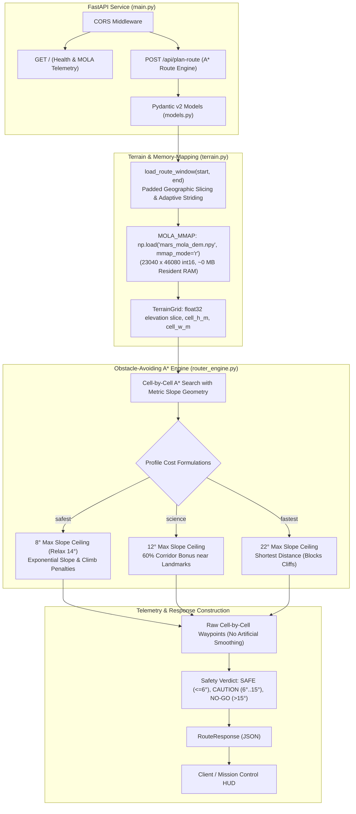

# Martian Map: System Architecture & Technical Specification

> **NASA Space Apps Challenge 2026** — Planetary-Scale Surface Traversal Engine for Mars.  
> Powered by the full-resolution **NASA MGS MOLA Global DEM (463 m/pixel)** via memory-mapped NumPy arrays.

---

## 1. System Architecture Overview

---

## 2. Key Technical Decisions & Invariants

1. **Zero-GDAL Runtime**:
   The 2 GB GeoTIFF is converted ahead-of-time via `convert_mola.py` into a raw binary `data/mars_mola_dem.npy` ($23,040 \times 46,080$ int16 array). Slicing via `mmap_mode="r"` executes in microseconds and consumes $\approx 0\text{ MB}$ of resident RAM.
2. **Raw A\* Fidelity**:
   Artificial smoothing / string-pulling is intentionally excluded. The API returns every discrete grid step directly from the elevation array, guaranteeing that every ridge detour and slope calculation is preserved verbatim.
3. **Adaptive Striding**:
   Local crater traverses ($\le 300 \times 300$) remain at 100% native 463 m/pixel resolution. Multi-thousand kilometer continental expeditions are strided to $\le 300 \times 300$, keeping response times under 40 milliseconds.

---

*Authored for the NASA Space Apps Challenge 2026.*
